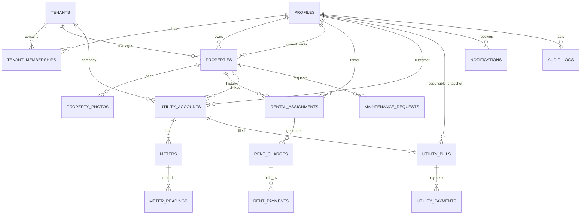

# IJAARO — Database Design Document

**Integrated Rental Property and Utility Management System**  
Version 1.1 | Companion to SYSTEM_DESIGN.md + BRD-1.md v1.1  
**Stack:** React.js · Tailwind CSS · shadcn/ui · **Supabase PostgreSQL + RLS**  
**Visual ERD:** open `ijaaro-database.erd.json` with **ERD Editor** (`dineug.vuerd-vscode`)

---

## 0. Secure design summary (v1)

| Principle | How |
| --- | --- |
| Multi-tenant SaaS | One shared schema; `tenant_id` on scoped tables |
| Isolation | PostgreSQL **RLS default-deny** + membership helpers |
| Auth | Supabase Auth; `profiles.id` = `auth.users.id` |
| RBAC | `tenant_memberships.role` — see BRD §7.2–7.3 |
| Approvals | Rent → landlord; water/electricity → same company tenant only |
| No duplicate premises | Single `properties` table; utility **search-then-link** |
| Historic debt | `utility_bills.responsible_party_id` immutable snapshot |
| Payments | Manual starts `pending`; API verified in Edge Functions; unique provider txn id |
| Audit | Append-only `audit_logs` |

**Canonical chain:** `properties` → `rental_assignments` → `rent_charges` → `rent_payments`  
and `properties` → `utility_accounts` → `meters` → `meter_readings` → `utility_bills` → `utility_payments`.

---

## 1. Design Goals

1. One shared schema for all tenants.
2. Every tenant-scoped row is isolatable via `tenant_id` (direct or through a secured parent).
3. Enforce business rules with constraints + transactions, not only application code.
4. Preserve history (tenancies, readings, bills, payments, audits).
5. Support Property ↔ Utility linking **without duplicate properties**.
6. Snapshot bill responsibility so new renters do not inherit old debt.

---

## 2. Conventions

| Convention | Value |
| --- | --- |
| Primary keys | `uuid` default `gen_random_uuid()` |
| Timestamps | `created_at`, `updated_at` (`timestamptz`) |
| Soft status | Prefer `status` enums over hard deletes for financial/history rows |
| Money | `numeric(12,2)` + `currency` (`text`, default `'USD'` or local) |
| Auth link | `profiles.id` = `auth.users.id` |
| Naming | `snake_case` tables/columns |
| Tenant column | `tenant_id uuid not null references tenants(id)` on scoped tables |

### Enum-style domains (PostgreSQL enums or check constraints)

```text
tenant_type:        platform | landlord | water_company | electricity_company
tenant_status:      pending | active | suspended | disabled
membership_status:  invited | active | disabled
app_role:           super_admin | landlord_admin | landlord_staff |
                    renter | utility_admin | utility_staff | utility_customer
property_status:    available | occupied | vacant
property_type:      apartment | house | shop | office | other
service_type:       water | electricity
assignment_status:  invited | active | completed | cancelled
charge_status:      due | partial | paid | overdue | cancelled
payment_status:     pending | processing | paid | rejected | failed | cancelled | refunded
payment_method:     cash | bank_transfer | mobile_money | card | other | api_provider
reading_status:     valid | estimated | corrected | reset | disputed
bill_status:        draft | issued | partial | paid | overdue | cancelled | disputed
maintenance_status: pending | in_progress | completed | cancelled
urgency:            low | medium | high
notification_channel: in_app | email | sms | whatsapp
delivery_status:    pending | sent | failed | read
```

---

## 3. Entity Relationship Overview

```text
auth.users ──1:1── profiles
                      │
                      │ N
                      ▼
                   tenant_memberships ──► tenants
                      │
properties ◄──────────┘ (landlord tenant owns properties)
    │
    ├── owner_profile_id (landlord user)
    ├── current_renter_id (profile, nullable)
    │
    ├── rental_assignments ──► renter profile
    │         │
    │         └── rent_charges ──► rent_payments
    │
    ├── maintenance_requests
    │
    └── utility_accounts (company tenant) ──► meters
                               │                 │
                               │                 └── meter_readings
                               │
                               └── utility_bills ──► utility_payments
                                      │
                                      └── responsible_party_id (profile snapshot)

staff_memberships (optional detail) ⊆ tenant_memberships for utility companies
notifications → recipient profile + tenant
audit_logs → actor + tenant + entity
subscriptions / platform_fees → tenant (optional)
```

### Canonical chain

```text
properties
  → rental_assignments (history of occupancy)
  → utility_accounts (water/electricity company tenants)
      → meters
          → meter_readings
      → utility_bills (responsible_party snapshot)
          → utility_payments
```

---

## 4. Table Specifications

### 4.1 Identity & tenancy

#### `profiles`
| Column | Type | Notes |
| --- | --- | --- |
| id | uuid PK | = `auth.users.id` |
| full_name | text | |
| phone | text | |
| email | text | denormalized for convenience |
| avatar_url | text | nullable |
| preferred_language | text | e.g. `so`, `en` |
| created_at / updated_at | timestamptz | |

#### `tenants`
| Column | Type | Notes |
| --- | --- | --- |
| id | uuid PK | |
| name | text not null | |
| slug | text unique not null | subdomain / path key |
| tenant_type | tenant_type not null | |
| status | tenant_status not null default `pending` | |
| branding | jsonb | logo, colors, display name |
| settings | jsonb | due-day defaults, etc. |
| created_at / updated_at | timestamptz | |

#### `tenant_memberships`
| Column | Type | Notes |
| --- | --- | --- |
| id | uuid PK | |
| tenant_id | uuid FK → tenants | |
| user_id | uuid FK → profiles | |
| role | app_role not null | |
| status | membership_status not null | |
| permissions | jsonb | optional overrides |
| invited_by | uuid FK → profiles | nullable |
| created_at / updated_at | timestamptz | |

**Constraints**

- `unique(tenant_id, user_id)`
- A user may belong to multiple tenants (e.g. renter + utility customer).

#### `staff_memberships` (utility operational detail — optional if covered by memberships)

Use when you need task-level permissions beyond role:

| Column | Type | Notes |
| --- | --- | --- |
| id | uuid PK | |
| tenant_id | uuid FK | water/electricity only |
| user_id | uuid FK | |
| staff_role | text | meter_reader, cashier, billing_clerk, admin |
| permitted_tasks | jsonb | |
| status | membership_status | |
| created_at / updated_at | timestamptz | |

`unique(tenant_id, user_id)`.

---

### 4.2 Properties & tenancy

#### `properties` (canonical premises — rental + utility)

| Column | Type | Notes |
| --- | --- | --- |
| id | uuid PK | public property ID for search/link |
| tenant_id | uuid FK | **landlord workspace** that manages listing; nullable only if created by utility first then reconciled |
| owner_id | uuid FK → profiles | landlord/owner person |
| current_renter_id | uuid FK → profiles | nullable |
| name | text | |
| address_line | text not null | |
| district | text | |
| city | text | |
| location_geo | point / geography | optional map pin |
| property_type | property_type | |
| description | text | |
| rent_amount | numeric(12,2) | listing rent |
| currency | text | |
| status | property_status | |
| contact_phone | text | |
| contact_email | text | |
| created_by_tenant_id | uuid FK | which tenant first registered it |
| created_source | text | `landlord` \| `water_company` \| `electricity_company` |
| is_listed | boolean | searchable by renters |
| created_at / updated_at | timestamptz | |

**Indexes:** `(status, district)`, `(tenant_id)`, `(owner_id)`, full-text or trigram on `address_line` for staff search.

**Note on OQ-06:** One table avoids duplicate premises. Utility-created rows can later set `tenant_id`/`owner_id` when a landlord claims/reconciles.

#### `property_photos`
| Column | Type | Notes |
| --- | --- | --- |
| id | uuid PK | |
| property_id | uuid FK | |
| tenant_id | uuid FK | denormalized for RLS |
| storage_path | text not null | |
| sort_order | int | |
| created_at | timestamptz | |

#### `rental_assignments` (tenancies history)
| Column | Type | Notes |
| --- | --- | --- |
| id | uuid PK | |
| tenant_id | uuid FK | landlord tenant |
| property_id | uuid FK | |
| landlord_id | uuid FK → profiles | |
| renter_id | uuid FK → profiles | |
| rent_amount | numeric(12,2) | |
| currency | text | |
| due_day | int | 1–28 recommended |
| start_date | date | |
| end_date | date | nullable until move-out |
| status | assignment_status | |
| notes | text | |
| created_at / updated_at | timestamptz | |

**Critical constraint (v1 single occupancy):**

```sql
-- Only one ACTIVE assignment per property
CREATE UNIQUE INDEX uq_property_one_active_assignment
ON rental_assignments (property_id)
WHERE status = 'active';
```

---

### 4.3 Rent ledger & payments

#### `rent_charges`
| Column | Type | Notes |
| --- | --- | --- |
| id | uuid PK | |
| tenant_id | uuid FK | landlord tenant |
| assignment_id | uuid FK | |
| property_id | uuid FK | |
| renter_id | uuid FK | |
| period_start | date | |
| period_end | date | |
| due_date | date | |
| amount_due | numeric(12,2) | |
| amount_paid | numeric(12,2) default 0 | |
| balance | numeric(12,2) generated or maintained | |
| status | charge_status | |
| created_at / updated_at | timestamptz | |

`unique(assignment_id, period_start, period_end)` recommended.

#### `rent_payments`
| Column | Type | Notes |
| --- | --- | --- |
| id | uuid PK | |
| tenant_id | uuid FK | landlord tenant |
| rent_charge_id | uuid FK | |
| property_id | uuid FK | |
| assignment_id | uuid FK | |
| payer_id | uuid FK → profiles | |
| amount | numeric(12,2) | |
| currency | text | |
| method | payment_method | |
| reference | text | manual txn ref |
| provider | text | nullable API provider name |
| provider_transaction_id | text | nullable; **unique where not null** |
| idempotency_key | text | unique where not null |
| proof_path | text | storage path |
| status | payment_status | |
| submitted_at | timestamptz | |
| reviewed_by | uuid FK | landlord reviewer |
| reviewed_at | timestamptz | |
| rejection_reason | text | required when rejected |
| created_at / updated_at | timestamptz | |

---

### 4.4 Utilities

#### `utility_accounts`
| Column | Type | Notes |
| --- | --- | --- |
| id | uuid PK | |
| tenant_id | uuid FK | **water or electricity company tenant** |
| property_id | uuid FK → properties | required link target |
| service_type | service_type | must match tenant type |
| account_number | text not null | unique per tenant |
| customer_id | uuid FK → profiles | account holder / customer |
| status | text | active/inactive/closed |
| effective_from | date | |
| effective_to | date | nullable |
| unit_price | numeric(12,4) | current default rate |
| extra_charges_config | jsonb | fixed fees, etc. |
| created_at / updated_at | timestamptz | |

**Constraints**

- `unique(tenant_id, account_number)`
- Check: water company tenants only create `service_type = water`, etc. (enforce in trigger/Edge Function)
- Multiple accounts per property allowed (water + electricity), but typically one active account per `(property_id, service_type, company_tenant)`.

Recommended:

```sql
CREATE UNIQUE INDEX uq_active_utility_per_property_service_tenant
ON utility_accounts (tenant_id, property_id, service_type)
WHERE status = 'active';
```

#### `meters`
| Column | Type | Notes |
| --- | --- | --- |
| id | uuid PK | |
| tenant_id | uuid FK | company tenant |
| utility_account_id | uuid FK | |
| meter_number | text not null | |
| service_type | service_type | |
| status | text | active/replaced/inactive |
| installed_at | date | |
| replaced_at | date | nullable |
| created_at / updated_at | timestamptz | |

`unique(tenant_id, meter_number)`.

#### `meter_readings`
| Column | Type | Notes |
| --- | --- | --- |
| id | uuid PK | |
| tenant_id | uuid FK | |
| meter_id | uuid FK | |
| utility_account_id | uuid FK | |
| reading_value | numeric(14,3) not null | |
| previous_reading_value | numeric(14,3) | snapshot |
| reading_date | date not null | |
| units_consumed | numeric(14,3) | computed |
| status | reading_status | |
| recorded_by | uuid FK → profiles | |
| correction_of_id | uuid FK → meter_readings | nullable self-FK |
| correction_reason | text | |
| notes | text | |
| created_at / updated_at | timestamptz | |

**Validation rules**

- Reject `reading_value < previous` unless `status in ('corrected','reset')` and reason present.
- Prefer one reading per meter per billing period (business rule via unique or app logic).

#### `utility_bills`
| Column | Type | Notes |
| --- | --- | --- |
| id | uuid PK | |
| tenant_id | uuid FK | company tenant |
| utility_account_id | uuid FK | |
| property_id | uuid FK | |
| meter_reading_id | uuid FK | nullable if estimated |
| service_type | service_type | |
| period_start | date | |
| period_end | date | |
| previous_reading | numeric(14,3) | |
| current_reading | numeric(14,3) | |
| units_consumed | numeric(14,3) | |
| unit_price | numeric(12,4) | snapshot |
| extra_charges | numeric(12,2) default 0 | |
| total_amount | numeric(12,2) | |
| amount_paid | numeric(12,2) default 0 | |
| balance | numeric(12,2) | |
| due_date | date | |
| status | bill_status | |
| **responsible_party_id** | uuid FK → profiles | **immutable snapshot** |
| responsible_party_role | text | `renter` \| `owner` |
| occupancy_snapshot | jsonb | optional: renter/owner ids at issue time |
| created_at / updated_at | timestamptz | |

**Do not update `responsible_party_id` when occupancy changes.**

#### `utility_payments`
| Column | Type | Notes |
| --- | --- | --- |
| id | uuid PK | |
| tenant_id | uuid FK | company tenant |
| utility_bill_id | uuid FK | |
| utility_account_id | uuid FK | |
| payer_id | uuid FK | |
| amount | numeric(12,2) | |
| currency | text | |
| method | payment_method | |
| reference | text | |
| provider | text | |
| provider_transaction_id | text | unique where not null |
| idempotency_key | text | unique where not null |
| proof_path | text | |
| status | payment_status | |
| submitted_at | timestamptz | |
| reviewed_by | uuid FK | company staff |
| reviewed_at | timestamptz | |
| rejection_reason | text | |
| created_at / updated_at | timestamptz | |

---

### 4.5 Maintenance, notifications, audit, optional SaaS

#### `maintenance_requests`
| Column | Type | Notes |
| --- | --- | --- |
| id | uuid PK | |
| tenant_id | uuid FK | landlord tenant |
| property_id | uuid FK | |
| renter_id | uuid FK | |
| category | text | plumbing, electrical, other… |
| urgency | urgency | |
| description | text not null | |
| photo_path | text | |
| status | maintenance_status | |
| created_at / updated_at | timestamptz | |

#### `notifications`
| Column | Type | Notes |
| --- | --- | --- |
| id | uuid PK | |
| tenant_id | uuid FK | nullable for platform-wide |
| recipient_id | uuid FK → profiles | |
| event_type | text | |
| channel | notification_channel | |
| title | text | |
| body | text | safe, non-sensitive |
| link_path | text | in-app route |
| delivery_status | delivery_status | |
| created_at | timestamptz | |
| read_at | timestamptz | |

#### `audit_logs`
| Column | Type | Notes |
| --- | --- | --- |
| id | uuid PK | |
| tenant_id | uuid | nullable for platform actions |
| actor_id | uuid | |
| action | text | e.g. `rent_payment.approve` |
| entity_type | text | |
| entity_id | uuid | |
| metadata | jsonb | safe fields only |
| created_at | timestamptz | append-only |

Prefer **no UPDATE/DELETE** grants on `audit_logs` for ordinary roles.

#### `subscription_plans` / `tenant_subscriptions` / `platform_fee_invoices` (optional)

Keep minimal if OQ-04 deferred:

- plans: name, price, limits jsonb, active
- tenant_subscriptions: tenant_id, plan_id, status, period dates
- platform_fee_invoices: tenant_id, amount, status, period

---

## 5. Relationship Summary (FK map)

| Child | Parent |
| --- | --- |
| tenant_memberships | tenants, profiles |
| properties | tenants (landlord), profiles (owner/renter) |
| property_photos | properties |
| rental_assignments | properties, profiles, tenants |
| rent_charges | rental_assignments, properties |
| rent_payments | rent_charges |
| utility_accounts | tenants (company), properties, profiles (customer) |
| meters | utility_accounts |
| meter_readings | meters, utility_accounts |
| utility_bills | utility_accounts, properties, profiles (responsible) |
| utility_payments | utility_bills |
| maintenance_requests | properties, profiles |
| notifications | profiles, tenants |
| audit_logs | profiles, tenants |

---

## 6. ERD (Mermaid)



---

## 7. RLS Design

### 7.1 Principles

1. Enable RLS on **all** tenant-scoped tables.
2. Default deny (no policy ⇒ no access).
3. Policies for SELECT / INSERT / UPDATE / DELETE as applicable.
4. Super Admin policies are narrow and audited.
5. Related tables without direct `tenant_id` must still be protected (prefer denormalized `tenant_id`).

### 7.2 Helper SQL (conceptual)

```sql
CREATE OR REPLACE FUNCTION public.is_super_admin()
RETURNS boolean
LANGUAGE sql STABLE SECURITY DEFINER SET search_path = public
AS $$
  SELECT EXISTS (
    SELECT 1 FROM tenant_memberships tm
    JOIN tenants t ON t.id = tm.tenant_id
    WHERE tm.user_id = auth.uid()
      AND tm.status = 'active'
      AND tm.role = 'super_admin'
      AND t.tenant_type = 'platform'
      AND t.status = 'active'
  );
$$;

CREATE OR REPLACE FUNCTION public.is_tenant_member(p_tenant_id uuid)
RETURNS boolean
LANGUAGE sql STABLE SECURITY DEFINER SET search_path = public
AS $$
  SELECT EXISTS (
    SELECT 1 FROM tenant_memberships
    WHERE user_id = auth.uid()
      AND tenant_id = p_tenant_id
      AND status = 'active'
  );
$$;

CREATE OR REPLACE FUNCTION public.has_tenant_role(p_tenant_id uuid, p_roles text[])
RETURNS boolean
LANGUAGE sql STABLE SECURITY DEFINER SET search_path = public
AS $$
  SELECT EXISTS (
    SELECT 1 FROM tenant_memberships
    WHERE user_id = auth.uid()
      AND tenant_id = p_tenant_id
      AND status = 'active'
      AND role::text = ANY (p_roles)
  );
$$;
```

### 7.3 Policy matrix (summary)

| Table | SELECT | INSERT | UPDATE | DELETE |
| --- | --- | --- | --- | --- |
| profiles | self; members who need contact fields carefully | self on signup trigger | self | no |
| tenants | members of tenant; super admin all | super admin / controlled registration | super admin / tenant admin (limited) | no hard delete |
| tenant_memberships | same tenant members (or self) | tenant admin / super admin | tenant admin | tenant admin soft-disable |
| properties | landlord tenant members; renters see listed available + own occupied; utility staff can search for link | landlord roles; utility staff (create premises) | landlord manage own; utility limited fields | soft only |
| rental_assignments | landlord tenant; assigned renter | landlord | landlord (status/dates) | no |
| rent_charges | landlord; owning renter | landlord / system | landlord / system | no |
| rent_payments | landlord; payer | payer (Pending only) | landlord review fields; system API | no |
| utility_accounts | company tenant staff; customer on own account | company staff | company staff | soft |
| meters / readings | company staff; customer of account | company staff | company staff (corrections audited) | no |
| utility_bills | company staff; responsible_party / customer | company/system | company/system amounts carefully | no |
| utility_payments | company staff; payer | payer Pending | company review only (same tenant + service) | no |
| maintenance_requests | landlord tenant; requesting renter | renter on own tenancy | landlord status | no |
| notifications | recipient only | system | recipient read_at | no |
| audit_logs | super admin; tenant admin limited | system/trigger only | **none** | **none** |

### 7.4 Payment approval enforcement (examples)

```sql
-- Landlord can update rent_payments only inside their tenant and only review fields
-- Utility staff can update utility_payments only when tenant_id matches their company
-- Cross-type updates must fail even if somehow attempted from UI
```

Application + Edge Functions must **also** verify:

- Rent approve ⇒ `has_tenant_role(tenant_id, ['landlord_admin','landlord_staff'])`
- Water approve ⇒ membership in that water tenant
- Electricity approve ⇒ membership in that electricity tenant

---

## 8. Indexes (performance essentials)

| Table | Index |
| --- | --- |
| tenant_memberships | `(user_id, status)`, `(tenant_id, role)` |
| properties | `(tenant_id)`, `(status, district)`, trigram `(address_line)` |
| rental_assignments | `(property_id, status)`, `(renter_id, status)` |
| rent_charges | `(renter_id, status)`, `(due_date)`, `(assignment_id)` |
| rent_payments | `(rent_charge_id)`, unique `(provider_transaction_id)` |
| utility_accounts | `(tenant_id)`, `(property_id)`, `(customer_id)`, `(account_number)` |
| meters | `(utility_account_id)`, `(tenant_id, meter_number)` |
| meter_readings | `(meter_id, reading_date desc)` |
| utility_bills | `(tenant_id, status)`, `(responsible_party_id)`, `(due_date)` |
| utility_payments | `(utility_bill_id)`, unique `(provider_transaction_id)` |
| maintenance_requests | `(tenant_id, status)`, `(property_id)` |
| notifications | `(recipient_id, created_at desc)` |
| audit_logs | `(tenant_id, created_at desc)`, `(entity_type, entity_id)` |

---

## 9. Transactional Operations

These must be multi-statement transactions (Edge Function or SECURITY DEFINER RPC):

| Operation | Writes |
| --- | --- |
| Assign renter | `rental_assignments` insert active; `properties` set renter + occupied; audit |
| Complete move-out | close assignment; clear `current_renter_id`; property available; audit |
| Approve rent payment | payment → paid; bump `rent_charges.amount_paid/status`; audit; notify |
| Apply API payment | verify idempotency; payment paid; charge/bill update once |
| Generate utility bill | reading validate; insert bill with responsibility snapshot; notify |
| Link utility account | find/create property once; insert account+meter; audit |
| Meter correction | insert correction reading linked to prior; audit |

---

## 10. Responsibility Snapshot Algorithm

When issuing a utility bill for `property_id`:

```text
IF property.current_renter_id IS NOT NULL AND status = occupied THEN
  responsible_party_id = current_renter_id
  responsible_party_role = 'renter'
ELSE
  responsible_party_id = property.owner_id
  responsible_party_role = 'owner'
END IF

Store occupancy_snapshot = {
  property_id, owner_id, current_renter_id, captured_at
}
```

Later renter changes **must not** update historical bills.

---

## 11. File Storage Mapping

| Bucket | Path pattern | Who can read |
| --- | --- | --- |
| property-photos | `{tenant_id}/{property_id}/{file}` | listing viewers / landlord |
| maintenance-photos | `{tenant_id}/{request_id}/{file}` | landlord + requesting renter |
| payment-proofs | `{tenant_id}/{payment_type}/{payment_id}/{file}` | payer + authorized reviewer |

Store only `storage_path` in DB; serve via signed URL after authz.

---

## 12. Migration Plan (aligned to roadmap)

| Migration package | Phase | Contents |
| --- | --- | --- |
| `001_foundation` | 1 | profiles, tenants, memberships, helpers, RLS base, audit_logs |
| `002_properties_tenancy` | 2 | properties, photos, rental_assignments, listing indexes |
| `003_rent_payments` | 3 | rent_charges, rent_payments, payment RLS |
| `004_utilities_link_meter` | 3 | utility_accounts, meters, readings, bill tables (issue may be Phase 4 UI) |
| `005_utility_ops_payments` | 4 | payment review policies, company report views |
| `006_maintenance_notify` | 5 | maintenance_requests, notifications |
| `007_subscriptions_optional` | 6 | plans/subscriptions if confirmed |
| `008_hardening` | 6 | extra indexes, monitoring views, tighter policies |

---

## 13. Seed / Reference Data (dev)

- 1 platform tenant + super admin
- 1 landlord tenant + landlord user + 2 properties
- 1 renter user (membership or renter role strategy)
- 1 water company + staff + linked account on property A
- 1 electricity company + staff + linked account on property A
- Sample readings/bills with different responsible parties for isolation tests

---

## 14. Isolation Test Cases (must pass)

1. Water Company A cannot SELECT Water Company B `utility_accounts`.
2. Landlord cannot UPDATE `utility_payments.status`.
3. Renter B cannot SELECT Renter A `rent_payments` / bills.
4. After move-out, old `utility_bills.responsible_party_id` unchanged.
5. Linking utility to existing property does not insert a second `properties` row.
6. Duplicate webhook with same `provider_transaction_id` does not double-pay.
7. Second `active` assignment on same property is rejected by unique index.
8. Disabled tenant membership cannot read tenant data.
9. Invalid subdomain/slug resolves to safe failure (app layer + no data leak).
10. Payment proof path is not readable by unrelated users.

---

## 15. Open Schema Decisions (track explicitly)

| ID | Topic | Current design choice |
| --- | --- | --- |
| OQ-05 | Landlord grouping | 1 landlord workspace = 1 tenant |
| OQ-06 | Premises model | Single `properties` table |
| OQ-07 | Partial payments | Supported via `amount_paid` + status `partial` |
| OQ-08 | Move-out with debt | Allowed; balances remain on historic charges/bills |
| OQ-10 | Role names | **Closed in BRD §7.2–7.3** — enums in §2 match finalized matrix |
| OQ-11 | Refunds | Column/status reserved; workflow deferred |

---

## 16. Minimal Permission Matrix (DB-oriented)

| Action | super_admin | landlord_* | renter | utility_* (own co.) | utility_customer |
| --- | --- | --- | --- | --- | --- |
| Manage tenants | ✓ | | | | |
| CRUD own properties | | ✓ | | create/link premises | |
| Assign/move-out | | ✓ | | | |
| Browse listings | | | ✓ | | |
| Submit rent payment | | | ✓ | | |
| Approve rent payment | | ✓ | | | |
| Manage meters/readings/bills | | | | ✓ | |
| Submit utility payment | | | ✓* | | ✓ |
| Approve water/electricity payment | | | | ✓ same service tenant | |
| Maintenance create | | | ✓ | | |
| Maintenance status | | ✓ | | | |
| Read audit (tenant) | ✓ | limited | | limited | |

\*If renter is also the utility responsible party / customer on the account.

---

## 17. What to Implement First in SQL

1. Extensions: `pgcrypto`, optional `pg_trgm`.
2. Enums + `profiles` + `tenants` + `tenant_memberships`.
3. RLS helpers + policies.
4. `audit_logs` append-only.
5. Then properties → assignments → payments → utilities.

Do **not** build payment tables without idempotency unique indexes and review audit columns.

---

*This database design implements BRD-1 v1.1 (rules BR-011–BR-026, permission matrix §7.3) and Architecture §3–§9. Open the visual model in ERD Editor via `ijaaro-database.erd.json`. Regenerate with `node scripts/generate-erd.mjs`. Pair with SYSTEM_DESIGN.md for component/workflow context.*
